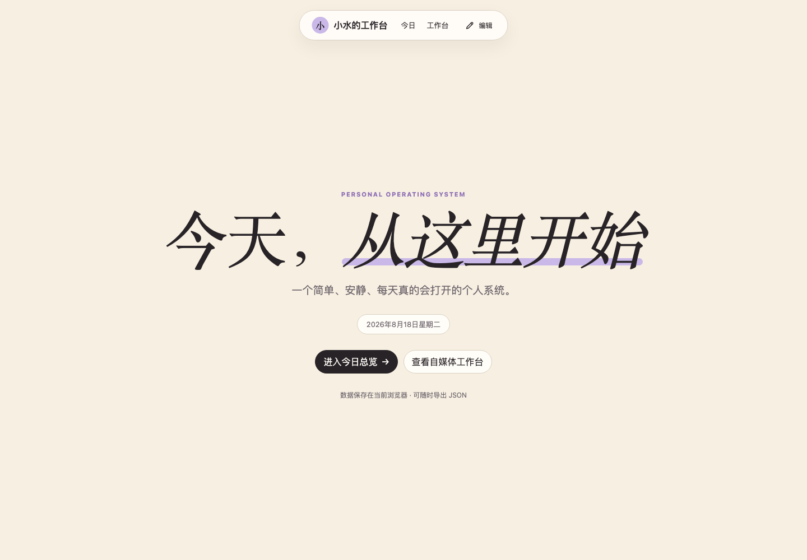
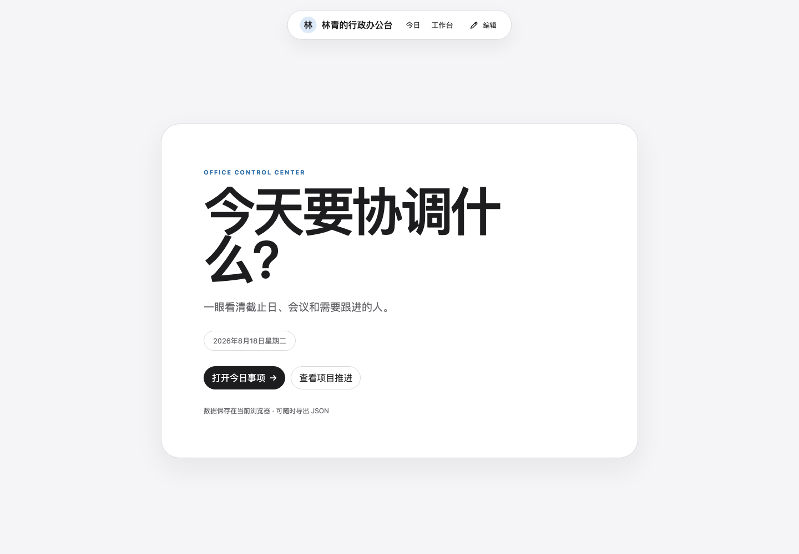
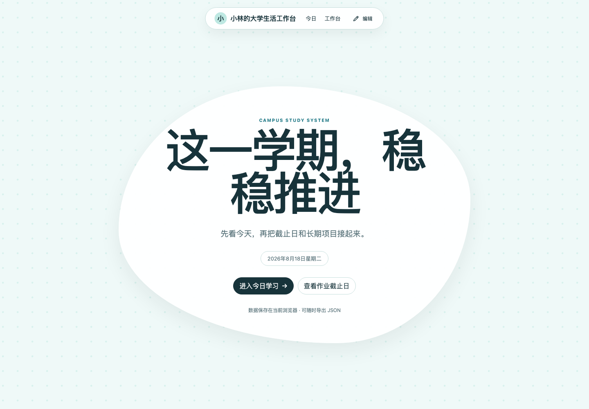
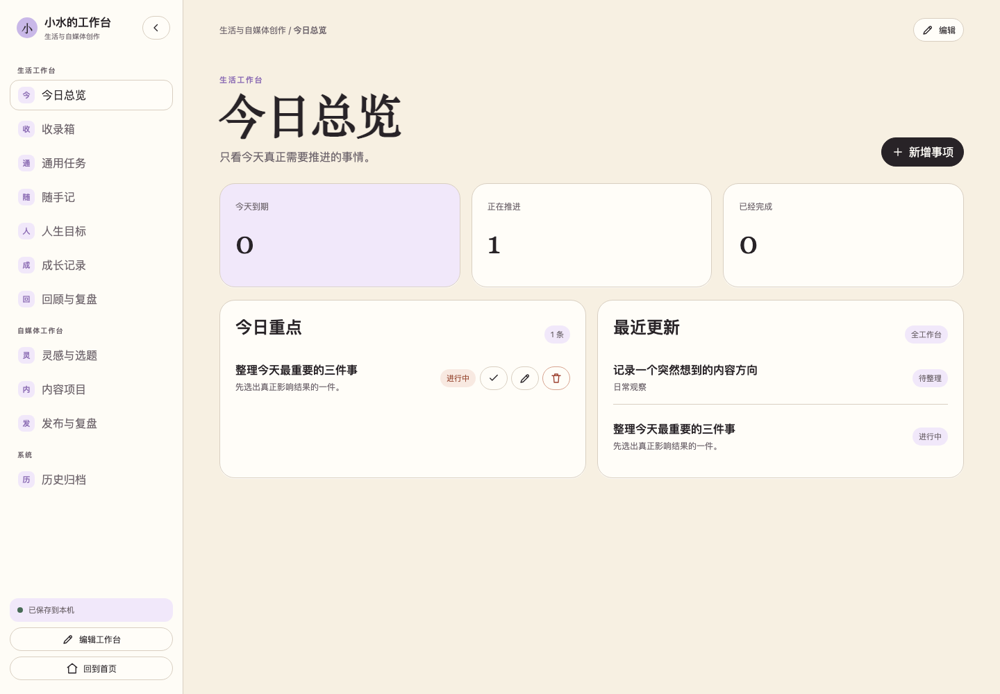

# XShui Workspace Builder｜小水工作台搭建师

> 把一句“我想做一个自己的工作台”，变成真正能记录、编辑、备份并长期使用的本地网页。

[](https://agentskills.io)
[](LICENSE)
[](docs/PRIVACY.md)



很多人并不缺待办工具，而是缺一套真正符合自己身份、工作方式和审美的个人系统。这个 Skill 会先了解你，再生成一套可以继续修改的源码，以及一个双击就能打开的独立 HTML。

## 直接使用进步计划

[下载完整 HTML](https://raw.githubusercontent.com/XshuiAi/xshui-workspace-builder/main/skills/xshui-workspace-builder/assets/examples/progress/index.html) · [使用说明与定制提示词](skills/xshui-workspace-builder/assets/examples/progress/README.md)

“老师，我太想进步了”示例包含阶段目标、行动进度、打卡与复盘，保留淡黄／紫色设计。已补齐首页快捷入口、正文编辑和各内页的图片编辑。下载 HTML 后可以直接使用，也可附给 AI 定制自己的目标。

## 立即安装

使用支持 [Agent Skills](https://agentskills.io) 的 AI 编程助手：

```bash
npx skills add XshuiAi/xshui-workspace-builder --skill xshui-workspace-builder -g
```

安装后直接对 Agent 说：

```text
请用 xshui-workspace-builder 帮我做一个自己的个人工作台。
我是一名自由职业者，希望管理客户项目、内容选题和每周复盘。
```

Agent 会分 2–3 轮完成需求访谈，先给你页面与功能方案；你确认以后，才会生成工作台。

完整步骤见[五分钟开始使用](docs/QUICKSTART.md)。如果你的 Agent 暂不支持通用安装器，可以把 [`skills/xshui-workspace-builder`](skills/xshui-workspace-builder) 整个目录复制到它的 Skill 目录。

## 你会得到什么

- 一套可继续开发的 HTML、CSS、JavaScript 和模板配置；
- 一个双击即可打开的 `dist/index.html`；
- 可新增、编辑、完成、筛选和删除的真实记录功能；
- 本地 IndexedDB 保存、JSON 备份、导入预览、合并与完整恢复；
- 可编辑文字、字号、行距、图片、导航顺序和模块显隐的受控编辑器；
- 数据使用说明、验证结果和后续交接文件。

它不是一张只有外观的网页截图，也不会用假按钮或假提示冒充功能完成。

## 三套起步模板

| 模板 | 适合谁 | 默认内容 |
|---|---|---|
| 小水工作台 | 生活管理、自媒体创作者、自由职业者 | 今日总览、收录箱、任务、随手记、目标、成长、复盘、灵感、内容项目、发布复盘 |
| 行政办公台 | 行政、助理、项目协调与日常办公 | 今日事项、任务优先级、会议、通知、文件链接、项目推进、工作记录、周报 |
| 大学生工作台 | 大学生与需要管理学习计划的人 | 今日学习、课程表、作业截止日、考试倒计时、学习项目、课堂笔记、社团、学期复盘 |





三个模板使用同一套数据、备份和编辑器内核。你也可以让 Agent 保留内核，重新组合自己的模块。

## 一次真实的使用过程

1. 你告诉 Agent 自己是谁、每天什么时候打开工作台、最想解决什么问题。
2. Agent 只追问会改变页面结构和数据字段的问题。
3. Agent 给出页面地图、模块、字段、按钮行为和数据保存位置。
4. 你确认方案。
5. Agent 生成源码和独立 HTML，并实际检查功能与手机布局。
6. 你双击打开 HTML，开始记录；以后可以在页面里自行修改文字和模块。



## 数据和隐私

- 业务数据默认只保存在当前浏览器的 IndexedDB；
- localStorage 只保存轻量偏好和应急配置；
- 第一版不上传数据，不接账号系统，也不伪装成跨设备同步；
- 清理浏览器数据、切换浏览器或更换设备前，请先导出 JSON 备份；
- 导入损坏、未知版本或校验失败的备份时，不会修改当前数据。

更完整的说明见[隐私与数据边界](docs/PRIVACY.md)。

## 这件事和“把 HTML 发给别人看”不同

这个 Skill 第一版解决的是：为个人生成并维护一份本地工作台。

- 把生成的 HTML 托管成公开网址，是“网站发布”；
- 多个人共同编辑同一份数据，是“账号、权限和云数据库”；
- 它们都不在第一版中，也不会被描述成已经支持。

## 兼容性

`SKILL.md` 保持平台无关，额外的 `agents/openai.yaml` 只用于 Codex 展示信息。当前项目已完成 Codex、Claude Code 和 WorkBuddy 的本地目录桥接检查；最终能否自动调用，取决于宿主是否支持 Agent Skills、读取本地文件和写入用户确认的项目目录。

## 示例与源码

- [小水工作台示例](examples/xiaoshui-demo)
- [行政办公台示例](examples/admin-demo)
- [大学生工作台示例](examples/student-demo)
- [Skill 真源](skills/xshui-workspace-builder)

示例姓名和记录均为虚构数据，不包含作者或用户的真实工作台内容。

## 开发与验证

```bash
python3 -m unittest discover -s tests -v
node tests/backup_runtime_test.js
```

三个默认样例可以使用各自的 `dist/index.html`。浏览器自动验收方法写在 [`tests/browser_smoke.py`](tests/browser_smoke.py) 中。

## 更新与许可证

版本变化见 [CHANGELOG.md](CHANGELOG.md)。项目采用 [MIT License](LICENSE)，第三方说明见 [THIRD_PARTY_NOTICES.md](THIRD_PARTY_NOTICES.md)。
